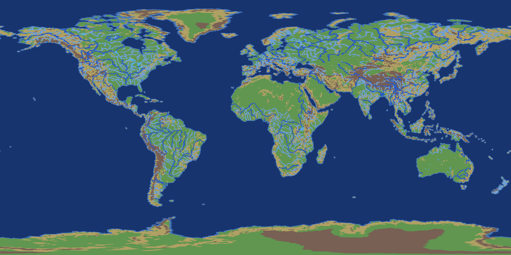

# sim2

A human history simulator. You watch civilization develop on Earth from 10,000 BCE into the future.

## Status

Milestone 0 (Skeleton) is in progress.

| Build step | State |
|---|---|
| 1. Grid and its tests | Done |
| 2. Earth import tool and world file | Done |
| 3. Clock, scheduler, random streams | Done |
| 4. World state, save and load, checksum | Not started |
| 5. Headless runner | Not started |
| 6. Viewer | Not started |



The imported Earth map: ocean, coast, lowland, hills and mountains. Lakes and ice arrive with milestone 1.

## Layout

- `src/Sim.Core`: the simulation core, a C# library with no Godot dependency.
- `src/Sim.Tools.EarthImport`: builds `data/earth.world` from elevation data. Runs in the "Earth import" GitHub Actions job.
- `tests/Sim.Core.Tests`: automated tests for the core.
- `data/earth.world`: the Earth map the simulator loads. `data/earth-overrides.txt` lists hand fixes for narrow straits and land bridges.

## Running the tests

Requires the .NET 8 SDK or later.

```
dotnet test sim2.sln
```

Tests also run on GitHub Actions on every push.

## Data

Elevation comes from the NOAA NCEI ETOPO 2022 Global Relief Model, 60 arc-second ice surface version (doi:10.25921/fd45-gt74).
