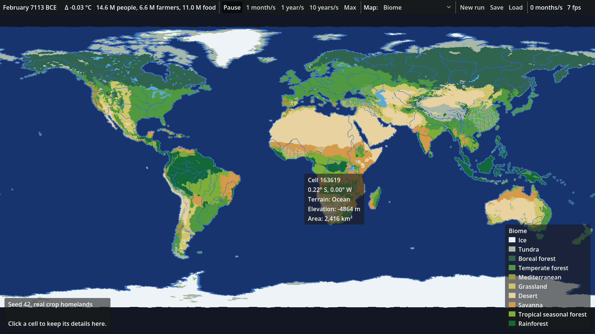

# sim2

A human history simulator. You watch civilization develop on Earth from 10,000 BCE into the future.

## Status

Milestone 0 (Skeleton) is complete and released as v0.1: the Earth map, the monthly clock, save and load, a windowless runner and the viewer. Nothing lives on the map yet. Milestone 1 (Land and people) is next.


The imported Earth map: ocean, coast, lowland, hills and mountains. Lakes and ice arrive with milestone 1.



## Download

Get `sim2-windows.zip` from the [Releases page](https://github.com/djeyprott/sim2/releases), unzip it and run `sim2.exe`. Windows will warn that the program is unsigned: choose "More info", then "Run anyway".

Controls: drag to move, mouse wheel to zoom, click a cell to select it, Space to pause or resume, keys 1 to 5 to set the speed.

## Layout

- `src/Sim.Core`: the simulation core, a C# library with no Godot dependency.
- `src/Sim.Tools.EarthImport`: builds `data/earth.world` from elevation data. Runs in the "Earth import" GitHub Actions job.
- `src/Sim.Headless`: runs the simulation with no window. See below.
- `viewer`: the Godot 4.6 project that displays the world. It only displays; all logic is in `Sim.Core`.
- `tests/Sim.Core.Tests`: automated tests for the core.
- `data/earth.world`: the Earth map the simulator loads. `data/earth-overrides.txt` lists hand fixes for narrow straits and land bridges.

## Running the tests

Requires the .NET 10 SDK or later.

```
dotnet test sim2.sln
```

Tests also run on GitHub Actions on every push.

## Running without a window

```
dotnet run --project src/Sim.Headless -c Release -- --world data/earth.world --seed 1 --years 1000 --save run.sav
```

Options: `--world` (map file), `--seed` (whole number, default 1), `--years` (default 100), `--load` (continue from a save), `--save` (write a save at the end). It prints the final date, ticks per second and the state checksum.

## Data

- Elevation: NOAA NCEI ETOPO 2022 Global Relief Model, 60 arc-second ice surface version (doi:10.25921/fd45-gt74).
- Climate: TerraClimate 1981-2010 monthly averages (Abatzoglou et al. 2018, Scientific Data 5:170191), public domain.
- Lakes and rivers: Natural Earth 10m physical vectors, public domain.
